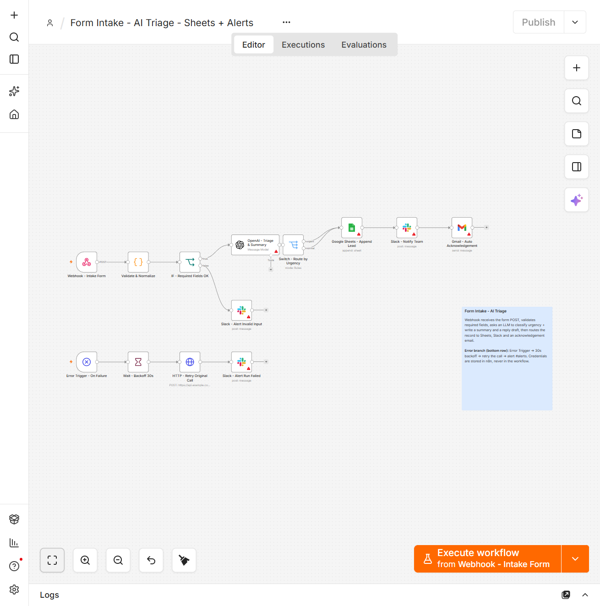

# n8n — Form Intake, AI Triage, Sheets + Alerts

A production-shaped n8n workflow that replaces "someone watches the contact form inbox"
with an automated pipeline: validate → LLM triage → route → log → notify → acknowledge,
with a failure branch that retries and shouts.



14 nodes, imported and run on **n8n 2.35.7** (self-hosted, community edition).

## What it does

1. **Webhook** receives the form `POST` on `/webhook/intake-form`.
2. **Validate & Normalize** (Code node) checks the required fields, trims and lowercases
   the email, and returns either `{valid: true, ...}` or `{valid: false, missing: [...]}`.
3. **IF — Required Fields OK** splits the two cases. Invalid input still produces a
   notification instead of a silent drop.
4. **OpenAI — Triage & Summary** asks `gpt-4o-mini` for JSON only: `urgency`,
   `category`, a one-sentence `summary` for the sales team, and a `suggestedReply`.
5. **Switch — Route by Urgency** sends `urgent` and `normal` down separate paths.
6. **Google Sheets — Append Lead**, then **Slack — Notify Team**, then
   **Gmail — Auto Acknowledgement** sends the drafted reply to the sender.
7. **Error branch** (bottom row): `Error Trigger` → `Wait 30s` → retry the original call
   → `Slack #alerts`, so a failed run is loud rather than invisible.

## Node reference

| Node | Type | Role |
|---|---|---|
| Webhook - Intake Form | `webhook` v2 | `POST /intake-form`, responds with a node response |
| Validate & Normalize | `code` v2 | required-field check, trim/lowercase, single output shape |
| IF - Required Fields OK | `if` v2 | boolean branch on `valid` |
| OpenAI - Triage & Summary | `@n8n/n8n-nodes-langchain.openAi` v1.1 | JSON-only classification + reply draft |
| Switch - Route by Urgency | `switch` v3.2 | two labelled outputs: `urgent`, `normal` |
| Google Sheets - Append Lead | `googleSheets` v4.5 | append to `Leads` sheet, column mapping defined explicitly |
| Slack - Notify Team | `slack` v2.2 | post to `#leads` |
| Gmail - Auto Acknowledgement | `gmail` v2.1 | replies to the submitter with the drafted text |
| Slack - Alert Invalid Input | `slack` v2.2 | post to `#alerts` with the missing field names |
| Error Trigger - On Failure | `errorTrigger` v1 | catches any failed execution |
| Wait - Backoff 30s | `wait` v1.1 | delays the retry instead of hammering the endpoint |
| HTTP - Retry Original Call | `httpRequest` v4.2 | re-issues the failed call, 15 s timeout |
| Slack - Alert Run Failed | `slack` v2.2 | last node executed + error message |

## Design decisions worth pointing at

* **Validation is a Code node, not a chain of IF nodes.** One place to read, one output
  contract, and the invalid path carries *which* fields were missing so the alert is
  actionable instead of "something failed".
* **The LLM is asked for JSON only, and the Switch parses it defensively** —
  `$json.message.content ? JSON.parse(...).urgency : $json.urgency` — so a model that
  returns plain text degrades to the fallback branch instead of throwing.
* **The error branch is a first-class path, not an afterthought.** Retry with 30 s
  backoff, then alert with `lastNodeExecuted` and the error message. Silent failure is
  the failure mode that actually costs money in automation work.
* **Credentials live in n8n's credential store, never in the workflow JSON.** The
  exported file in this repo contains no secrets — the placeholder values
  (`YOUR_SHEET_ID`, `https://api.example.com/retry`) mark where your own values go.
* **The workflow file is version-controllable.** It is a plain JSON export, so it can be
  reviewed in a pull request, diffed between versions, and restored after a mistake.

## Import

```bash
# CLI
n8n import:workflow --input=workflow/form-intake-ai-triage.json

# UI: Workflows -> ... -> Import from File -> select the JSON
```

The import is **inactive by default** (`"active": false`). Activate it only after the
credentials below are attached and the sheet ID is replaced.

Then test the webhook without wiring up a real form:

```bash
curl -X POST http://localhost:5678/webhook/intake-form \
  -H "Content-Type: application/json" \
  -d '{"name":"Dana Reed","email":"Dana@Example.com","company":"Northline",
       "message":"Our invoice exports take two days every month and we keep missing cut-off."}'
```

Expected: a row appended to `Leads`, a message in `#leads`, an acknowledgement email to
the sender, and HTTP 200 back from the webhook.

Also call it with `{"name":"","email":"","message":""}` — that is the path that exercises
the invalid-input alert, and it is the one people forget to test.

## Credentials checklist

See [`docs/credentials-checklist.md`](docs/credentials-checklist.md) for the handover
version of this list.

| Purpose | Nodes | Credential type |
|---|---|---|
| LLM triage | OpenAI - Triage & Summary | OpenAI API key |
| Lead log | Google Sheets - Append Lead | Google Sheets OAuth2 (needs edit access to the target file) |
| Team alerts | 3 × Slack | Slack OAuth2 or bot token with `chat:write` |
| Acknowledgement | Gmail - Auto Acknowledgement | Gmail OAuth2 |

Minimum scopes and the two Google-side gotchas (sharing the *file* with the service
account / OAuth user, and enabling the Sheets API) are in the checklist.

## What changes for a real deployment

The JSON here is a working template, not a drop-in. On a paid job the parts that get
rewritten are:

* the **validation rules** (which fields are actually required, format checks, spam and
  duplicate-submission handling),
* the **routing rules** (urgency is rarely just two buckets; SLA timers usually appear),
* the **lead destination** (Sheets is fine for a small team, Airtable/CRM/HubSpot once
  volume grows past a few hundred a month),
* **idempotency** — if the form can be submitted twice, a dedupe check on email +
  timestamp key belongs before the Sheets append.

## Limitations

* Retry is single-shot with a fixed 30 s backoff. For a rate-limited API, exponential
  backoff with jitter is the correct version — the shape is the same, the `Wait`
  node's delay just becomes computed.
* The `HTTP - Retry Original Call` node retries *a* call, not automatically *the failed
  node* — n8n has no built-in "re-run from the failed node" expression. For real use,
  the more robust pattern is `Retry On Fail` on the fragile nodes plus this branch as the
  final alert.
* No queueing. A burst of submissions runs concurrently; if the downstream API has a
  concurrency limit, add `Split In Batches` or `Limit`.
* Gmail's automated reply comes from a human-looking mailbox. Check the client's
  expectations before enabling it — some teams prefer a reply-to address instead.

## License

MIT — see [LICENSE](LICENSE). The workflow is a template; replace the placeholder
endpoints and IDs with your own before running it.
